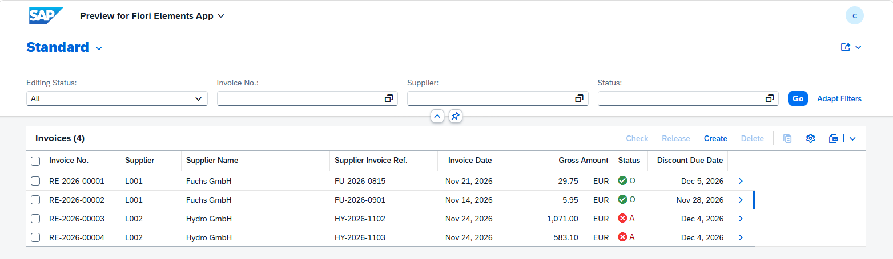
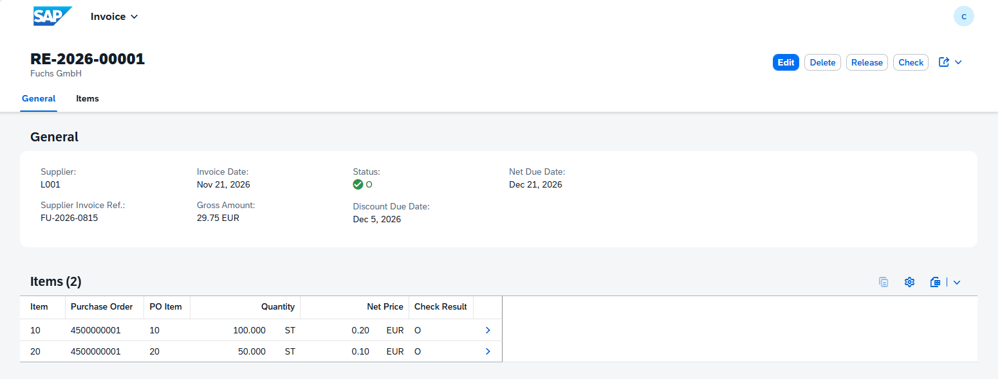
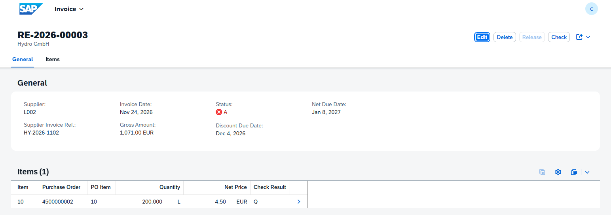
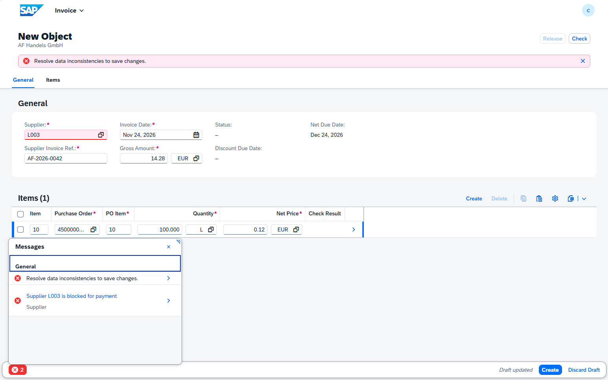
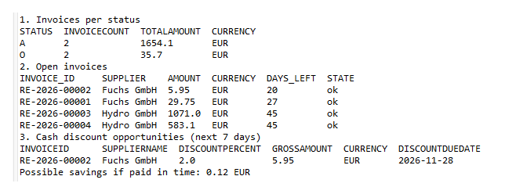

# InvoiceGuard Dokumentation

## Projektbeschreibung

InvoiceGuard ist eine SAP-Fiori-App zur Prüfung von Lieferantenrechnungen. Bevor eine Rechnung zur Zahlung freigegeben wird, vergleicht die App sie mit der **Bestellung** und dem **Wareneingang** (3-Way-Match). Mengen- und Preisabweichungen werden automatisch erkannt, gesperrte Lieferanten und doppelte Rechnungen abgewiesen, und freigegebene Rechnungen sind durch ein Vier-Augen-Prinzip geschützt.

Das Projekt ist parallel zu meiner Weiterbildung zum SAP-ABAP-Cloud-Entwickler entstanden (S4D400 / S4D401, Ziel-Zertifizierung C_ABAPD). Es folgt dem **Clean-Core**-Ansatz von SAP: ausschließlich ABAP Cloud und freigegebene APIs, kein klassisches ABAP.

### Fachlicher Hintergrund

In der Kreditorenbuchhaltung darf eine Rechnung nicht einfach bezahlt werden, nur weil sie angekommen ist. Beim 3-Way-Match werden drei Belege verglichen:

- **Bestellung:** Was haben wir zu welchem Preis bestellt?
- **Wareneingang:** Was wurde tatsächlich geliefert?
- **Rechnung:** Was berechnet der Lieferant?

Nur wenn alle drei zusammenpassen, darf die Rechnung freigegeben werden.

## Funktionen

- Rechnungen mit Positionen erfassen, auch als Entwurf (Draft)
- Automatische Rechnungsnummer `RE-JJJJ-NNNNN`, vergeben erst beim endgültigen Speichern
- Skontofrist und Fälligkeit werden aus den Zahlungsbedingungen des Lieferanten berechnet, sofort bei der Eingabe
- Prüfungen beim Speichern: Lieferant existiert und ist nicht gesperrt, Betrag größer als null, Pflichtfelder, Dublettenprüfung
- 3-Way-Match per Knopfdruck („Check“): Menge ≤ gelieferte Menge, Preisabweichung ≤ 2 %, Ergebnis pro Position und pro Rechnung
- Freigabe („Release“) nur für geprüfte Rechnungen ohne Abweichung
- Freigegebene Rechnungen können nicht mehr bearbeitet, gelöscht oder neu geprüft werden
- Vier-Augen-Prinzip: Wer eine Rechnung erfasst hat, darf sie nicht selbst freigeben
- Statusfarben: Abweichung rot, geprüft und freigegeben grün
- Wertehilfen für Lieferant, Währung und Bestellposition
- Auswertung: Rechnungen pro Status, offene Rechnungen mit Fälligkeit, Skonto-Chancen der nächsten 7 Tage mit möglicher Ersparnis
- ABAP-Unit-Tests für die Prüfregeln, inklusive Grenzfällen

## Screenshots

### Rechnungsliste

Übersicht aller Rechnungen mit Status und Statusfarbe. Über die Buttons „Check“ und „Release“ wird geprüft und freigegeben.



### Rechnung mit Positionen

Detailseite einer Rechnung mit Kopfdaten, berechneten Fristen und Rechnungspositionen.



### Prüfergebnis

Nach dem 3-Way-Match: Eine Position hat eine Mengenabweichung (Q), die Rechnung bekommt den Status A (Abweichung).



### Validierung

Ein gesperrter Lieferant wird beim Speichern abgewiesen, die Meldung erscheint direkt am Feld.



### Auswertung

Konsolenausgabe mit Statusübersicht, offenen Rechnungen und möglicher Skonto-Ersparnis.



## Verwendete Technologien

- SAP BTP, ABAP Environment (Trial)
- ABAP Cloud
- ABAP RESTful Application Programming Model (RAP): managed, Draft, EML
- Core Data Services (CDS): View Entities, Associations, Compositions, Aggregationen
- SAP Fiori Elements (OData V4)
- ABAP Unit
- Eclipse mit ABAP Development Tools (ADT)
- abapGit, Git/GitHub

## Aufbau der Anwendung

```
 Fiori-Elements-App (Liste + Detailseite)
        │  OData V4
 Service            ZUI_IG_INVOICE / ZUI_IG_INVOICE_O4
        │
 Projektion         ZC_IG_Invoice, ZC_IG_InvoiceItem + Metadata Extensions (Oberfläche)
        │
 Business Object    ZR_IG_Invoice (Rechnung) ──► ZR_IG_InvoiceItem (Position)
        │           Behavior Pool ZBP_R_IG_INVOICE: Determinations, Validierungen, Aktionen
        │
        ├──► ZCL_IG_MATCHER ──► ZIF_IG_CHECK_RULE ◄── ZCL_IG_RULE_QUANTITY
        │                                         ◄── ZCL_IG_RULE_PRICE
        │
 CDS-Views          ZI_IG_Supplier, ZI_IG_Material, ZI_IG_PurchaseOrder,
                    ZI_IG_PurchaseOrderItem, ZI_IG_GoodsReceipt, ZI_IG_GoodsReceiptSum
        │
 Datenbank          ZIG_LIEFERANT, ZIG_MATERIAL, ZIG_PO, ZIG_PO_ITEM, ZIG_GR,
                    ZIG_INVOICE, ZIG_INVOICE_ITEM
```

### Wichtige Entscheidungen

- **Prüfregeln als eigene Klassen hinter einem Interface.** Jede Regel implementiert `ZIF_IG_CHECK_RULE`, der Matcher ruft alle Regeln nacheinander auf. Eine neue Regel ist eine neue Klasse, der bestehende Code bleibt unverändert. Die Regeln greifen nicht auf die Datenbank zu und lassen sich deshalb einfach testen.
- **Gelieferte Menge als CDS-Summe.** `ZI_IG_GoodsReceiptSum` summiert Teillieferungen pro Bestellposition.
- **Technischer Schlüssel sofort, Rechnungsnummer erst beim Speichern.** So entstehen keine Lücken durch verworfene Entwürfe.
- **Nur freigegebene APIs**, z. B. `cl_abap_context_info` statt `sy-datum` und `sy-uname`.

## Datenbank

| Tabelle | Inhalt |
| --- | --- |
| `ZIG_LIEFERANT` | Lieferant mit Zahlungsbedingungen und Sperrkennzeichen |
| `ZIG_MATERIAL` | Material |
| `ZIG_PO` / `ZIG_PO_ITEM` | Bestellkopf / Bestellpositionen |
| `ZIG_GR` | Wareneingänge (Teillieferungen möglich) |
| `ZIG_INVOICE` / `ZIG_INVOICE_ITEM` | Rechnungskopf / Rechnungspositionen |

Eine Bestellung hat mehrere Positionen, eine Bestellposition kann mehrere Wareneingänge haben. Jede Rechnungsposition verweist auf eine Bestellposition.

### Testdaten

| Bestellposition | Bestellt | Geliefert | Testet |
| --- | --- | --- | --- |
| 4500000001 / 00010 | 100 Stück | 100 | alles in Ordnung |
| 4500000001 / 00020 | 50 Stück | 30 + 20 | zwei Teillieferungen |
| 4500000002 / 00010 | 200 L | 120 | Mengenabweichung |
| 4500000002 / 00020 | 500 Stück | 0 | noch nichts geliefert |
| 4500000003 / 00010 | 100 Stück | 100 | Lieferant L003 ist gesperrt |

## Installation und Start

### Voraussetzungen

- SAP BTP ABAP Environment (z. B. Trial)
- Eclipse mit ABAP Development Tools (ADT)
- abapGit-Plugin für Eclipse

### Projekt starten

1. Im ABAP Environment ein Paket anlegen (z. B. `ZINVGUARD`).
2. In Eclipse die View **abapGit Repositories** öffnen und dieses Repository mit dem Paket verknüpfen.
3. Pull ausführen und alle Objekte aktivieren.
4. Klasse `ZCL_IG_FILL_DATA` mit F9 ausführen, um Testdaten anzulegen.
5. Service Binding `ZUI_IG_INVOICE_O4` öffnen, veröffentlichen und die Vorschau für `Invoice` starten.

## Aufbau des Projekts

```
InvoiceGuard/
├─ Implementierung/src/   ABAP-Objekte (abapGit)
├─ Planungsdokumente/     Projektauftrag, Tickets, Datenmodell
├─ Dokumentation/         Screenshots
└─ README.md
```

Umgesetzt in 12 Tickets mit je eigenem Commit (`T01` bis `T12`), von den Tabellen bis zu den Unit-Tests.

## Bekannte Einschränkungen

- Im Trial gibt es nur einen Benutzer, deshalb lässt sich der Fall „Freigabe durch eine andere Person“ nicht live zeigen.
- Die Rechnungsnummer wird über `MAX()` ermittelt. Produktiv würde man ein Nummernkreisobjekt verwenden.

## Autor

Ahmet Aktas

[GitHub](https://github.com/AhmetAktas67) · [LinkedIn](https://www.linkedin.com/in/ahmet-aktas-707ab8424) · [Portfolio](https://ahmetaktas.xyz)

## Hinweis

Die Screenshots zeigen Beispieldaten. Die Oberfläche und die Objektnamen sind auf Englisch, die Dokumentation auf Deutsch.
